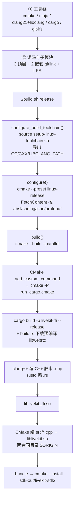
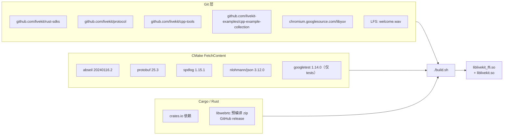
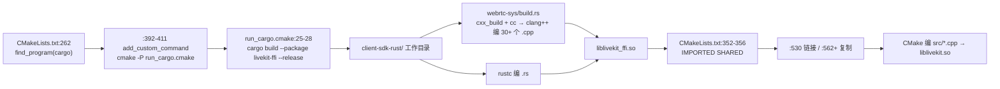
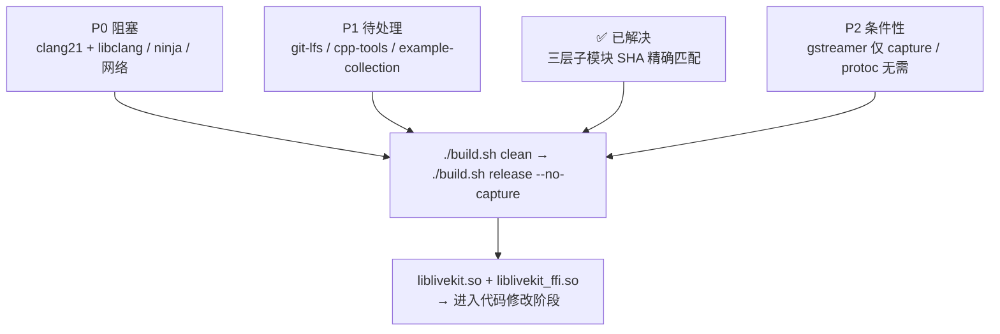

# 如何编译 LiveKit C++ SDK（编译专题）

> 分析基线：`client-sdk-cpp` @ `980332b`（main），`client-sdk-rust` 锁定 `ede8ac53843a8fb91d6f4fb5629f5245f1758e38`。
> 本文**只谈编译**：工具链、依赖拉取、配置、产物、排错。不涉及业务代码、API 或架构改造。
> 环境状态为 2026-11-11 本机实测；所有"如何修"给出的是可执行命令，但**我没有执行它们，也没有完成一次实际构建**。

---

## 0. 结论速览

**编译入口只有一个：`./build.sh`（Linux/macOS）/ `build.cmd`（Windows）。`AGENTS.md` 明确禁止直接调用 CMake 构建 SDK。**

一次成功编译 = 三件事都就位：

1. **工具链**：CMake ≥3.25、Ninja、clang/clang++ **21+ 且配套 libclang**、Rust stable、Git LFS。
2. **源码与子模块**：3 个顶层 gitlink + 2 个嵌套 gitlink 全部初始化，LFS 对象拉取成功。
3. **网络依赖**：CMake FetchContent 下载 4 个第三方源码包、Cargo 下载 crates.io 依赖、Rust 构建脚本下载预编译 libwebrtc。

**当前本机实测：第 1 项严重缺失，第 2 项部分缺失，第 3 项尚未触发（因为还没构建）。**

| 项 | 实测值 | 要求 | 状态 |
|---|---|---|---|
| `cmake` | 4.2.3 | ≥ 3.25 | ✅ 满足 |
| `cargo` / `rustc` | 1.93.1 | stable | ✅ 满足 |
| `pkg-config` | 2.5.1 | 需要 | ✅ 满足 |
| `openssl` (pkg-config) | 3.5.5 | 系统库 | ✅ 满足 |
| `ninja` | **未安装** | `CMakePresets.json` 的 linux-base 用 Ninja generator | 🔴 阻塞 |
| `clang` / `clang++` | **未安装** | 21+ | 🔴 阻塞 |
| `clang-21` / `clang++-21` | **未安装** | 21+ | 🔴 阻塞 |
| `libclang-21` (`libclang.so`) | **未找到** | `setup-linux-toolchain.sh` 强制要求 | 🔴 阻塞 |
| `protoc` | **未安装** | **不需要**（Linux 走 vendored protoc） | ⚪ 无需处理 |
| `git-lfs` | **未安装** | 拉 `data/welcome.wav` | 🟡 待处理 |
| `gstreamer-1.0` | **未安装** | 仅 `--capture` 含 `gstreamer` 时需要 | 🟡 条件性 |
| `client-sdk-rust` | `ede8ac5` 已初始化 | 编译必需 | ✅ 本次已解决 |
| 嵌套 `livekit-protocol/protocol` | `3fbe5098` 已初始化 | 编译必需 | ✅ 本次已解决 |
| 嵌套 `yuv-sys/libyuv` | `91727608` 已初始化 | 编译必需 | ✅ 本次已解决 |
| `cpp-tools` | **空目录** | **编译不需要**；本地 lint 需要 | 🟡 待处理 |
| `cpp-example-collection` | `-` 未初始化 | 仅 `-examples` / `-all` preset 需要 | 🟡 条件性 |
| 网络 | github.com / googlesource 间歇性 TCP 不通 | 所有拉取环节 | 🔴 需规避 |

> 符号说明：🔴 会直接让编译失败；🟡 视构建选项而定或只影响开发体验；⚪ 看起来缺、其实不用装。

---

## 1. 编译全景



关键点：**C++ 编译器和 rustc 都要上场**，由 `build.sh` → CMake → cargo → `build.rs` 逐层调度。这不是纯 Rust 构建，也不是纯 C++ 构建。

---

## 2. 前置一：工具链

### 2.1 硬性要求

`docs/building.md:9-22` 的核心工具表：

| 工具 | 要求 | 谁在用 |
|---|---|---|
| CMake | ≥ 3.25 | `build.sh` 通过 `CMakePresets.json`（version 6）配置 |
| Ninja | 必需（Linux/macOS preset） | `CMakePresets.json:53-69` 的 `linux-base` / `macos-base` 指定 `"generator": "Ninja"` |
| Rust / Cargo | 最新 stable | 编译 `client-sdk-rust/livekit-ffi` |
| clang / clang++ | **21+，且两者同版本** | 编译 `webrtc-sys/src/*.cpp` 和 C++ SDK `src/*.cpp` |
| libclang | 与 clang 同版本 | 供 cxx / UniFFI 绑定生成使用 |
| Git + LFS | 需要 | 子模块与 `data/welcome.wav` |
| pkg-config / OpenSSL / libcurl | 系统库 | `docs/building.md:37-40` |

### 2.2 `setup-linux-toolchain.sh` 的选择逻辑（必须 source）

`build.sh:45-50` 在 Linux 上执行 `source scripts/setup-linux-toolchain.sh`。脚本 `:17-21` 会**拒绝被直接执行**（因为要 `export` 变量到当前 shell）。

选择顺序（`scripts/setup-linux-toolchain.sh:90-140`）：

1. `LLVM_ROOT` 显式指定 → 用 `${LLVM_ROOT}/bin/clang{,++}`
2. 否则 `CC` / `CXX` 都设了 → 用它们（只设一个会报错）
3. 否则扫 `/opt/llvm-*`（按版本倒序）
4. 否则从 `clang-40` 递减找到 `clang-21`
5. 最后试裸 `clang` / `clang++`

每个候选都要通过 `livekit_select_linux_clang_pair()`（`:66-88`）的三重校验：clang major ≥ 21、CC/CXX 版本一致、能找到 `libclang.so`（排除 `*-cpp.*`，`:39-64`）。全部失败则报：

```
ERROR: Linux builds require clang/clang++ 21+ and libclang.
Ubuntu 22.04 and 24.04 distro clang versions are too old.
Install clang-21 from apt.llvm.org or set LLVM_ROOT to a compatible LLVM installation.
```

成功时打印 `CC=` / `CXX=` / `LIBCLANG_PATH=`（`:136-139`）。

### 2.3 为什么不能用 GCC / 系统自带的旧 clang

`webrtc-sys/build.rs:531-547`：预编译的 `libwebrtc.a` 用 Chromium 的 **hermetic libc++**（与系统隔离的 C++ 标准库），其 `trivial_abi` 标注会改变调用约定（ABI，二进制层面传参/返回值的规则）。GCC 会接受却静默忽略该属性，导致 `libwebrtc.a` 把 `std::unique_ptr` 放在寄存器返回、而 GCC 调用方去 sret 槽读，第一次使用就是野指针。因此 Linux 强制 `clang++`，且 `setup-linux-toolchain.sh:546` 直接 `builder.compiler("clang++")`。

Ubuntu 22.04 自带 clang 14、24.04 自带 clang 18（`:130`、`docs/building.md:76-77`），都不够。

### 2.4 安装命令（Linux / Ubuntu）

来自 `docs/building.md:65-93` 与 `.github/actions/setup-sdk-deps/action.yml:33-76`：

```bash
# 基础包（含 ninja、git-lfs、pkg-config、系统库）
sudo apt update && sudo apt install -y \
  build-essential cmake ninja-build pkg-config git git-lfs curl \
  libglib2.0-dev libssl-dev libcurl4-openssl-dev \
  wget ca-certificates gnupg lsb-release

# clang 21（发行版自带版本太旧，走 apt.llvm.org）
sudo install -m 0755 -d /etc/apt/keyrings
wget -qO- https://apt.llvm.org/llvm-snapshot.gpg.key \
  | sudo tee /etc/apt/keyrings/llvm.asc >/dev/null
sudo chmod a+r /etc/apt/keyrings/llvm.asc
codename=$(lsb_release -cs)
echo "deb [signed-by=/etc/apt/keyrings/llvm.asc] http://apt.llvm.org/${codename}/ llvm-toolchain-${codename}-21 main" \
  | sudo tee /etc/apt/sources.list.d/llvm-21.list >/dev/null
sudo apt update
sudo apt install -y clang-21 libclang-21-dev   # libclang 必须齐

# Rust（若未装）
curl https://sh.rustup.rs -sSf | sh
. "$HOME/.cargo/env"

# 验证
source scripts/setup-linux-toolchain.sh
```

> Ubuntu 22.04 自带 CMake 3.22 < 3.25，需另装（`docs/building.md:73-74`）；本机是 4.2.3，已满足。

### 2.5 一个容易误判的点：`protoc` 不用装

`cmake/protobuf.cmake:110-207`：Linux/macOS 走 **vendored** 路径，通过 FetchContent 下载并编译 protobuf 25.3，自己产出 `protobuf::protoc`（`:201-207`），再由 `cmake/run_cargo.cmake:41` 把 `PROTOC` 环境变量传给 cargo。所以系统 `protoc` 缺失**不是问题**——但 FetchContent 必须从 GitHub 下到那两个 tarball（见第 4 章）。只有显式 `-DLIVEKIT_USE_SYSTEM_PROTOBUF=ON`（`protobuf.cmake:89-108`）或 Windows/vcpkg 路径才用系统 protoc。

---

## 3. 前置二：源码、子模块与 LFS

### 3.1 三层 gitlink 与版本契约

`.gitmodules`（顶层）与 `client-sdk-rust/.gitmodules`（嵌套）：

| 路径 | 来源 | 锁定的 commit | 编译是否需要 |
|---|---|---|---|
| `client-sdk-rust` | github.com/livekit/rust-sdks.git | `ede8ac5…` | **必需**（Rust FFI 源码 + proto 定义） |
| `client-sdk-rust/livekit-protocol/protocol` | github.com/livekit/protocol | `3fbe5098…` | **必需**（protobuf 定义） |
| `client-sdk-rust/yuv-sys/libyuv` | chromium.googlesource.com/libyuv/libyuv | `91727608…` | **必需**（libyuv 源码） |
| `cpp-tools` | github.com/livekit/cpp-tools.git | `4dc3762…` | 编译**不需要**（lint/format 配置） |
| `cpp-example-collection` | github.com/livekit-examples/cpp-example-collection.git | `7abd4b9…` | 仅 `-examples` / `-all` preset |

版本由 **gitlink（子模块指针，git 里 `160000 commit` 类型，只存 SHA）** 决定，不是分支或 tag。`git submodule update --init --recursive` 默认 checkout 到这个 SHA（detached HEAD，HEAD 直接指向某个 commit 而不挂分支名）；**绝不能加 `--remote`**，否则会拉远端最新并改写 pin，破坏版本匹配。

`.github/workflows/rust-release-check.yml` 还会校验 pinned commit 对应一个已发布 release，防止基于未发布的 Rust commit 发版。

### 3.2 Git LFS

`.gitattributes:1`：`data/welcome.wav filter=lfs diff=lfs merge=lfs -text`。这是测试用的音频资产，需要 `git lfs pull`（`docs/building.md:133-134`、`builds.yml:65-66`）。本机 `git-lfs` 未安装，所以这一步还不能跑。

### 3.3 本次拉取 `client-sdk-rust` 失败的完整复盘

用户明确要求把这段写进文档，因为它是"依赖拉取"最真实的教训。

| 轮次 | 命令 | 结果 |
|---|---|---|
| 1 | `git submodule update --init --recursive client-sdk-rust` | **39 分钟失败**：`curl 56 Recv failure: 连接超时`、`预期仍然需要 4263 / 46199 个字节的正文`、`HTTP/2 stream 5 was not closed cleanly: CANCEL`、`过早的文件结束符(EOF)`、`index-pack 输出无效`。git 自动重试一次仍失败 |
| 2 | 改用 `git -c http.version=HTTP/1.1 -c http.lowSpeedLimit=0 -c http.lowSpeedTime=999999 submodule update --init --filter=blob:none --recursive client-sdk-rust` | **主仓库成功** checkout `ede8ac5`；但第二层嵌套子模块 `livekit/protocol`、`yuv-sys/libyuv` 全部 TCP 连接超时（~135s）/ SSL EOF，命令退出 1 |
| 3 | 单独重试两个嵌套子模块 | 仍稳定失败，`git submodule status` 保持 `-` 前缀（未初始化） |
| 4 | 用 `https://ghfast.top/` 前缀 + `url.<base>.insteadOf` 临时重写（**命令级 `-c`，不改 `.gitmodules`、不持久化**） | `protocol` 一次成功，checkout `3fbe5098`；`googlesource` 经该前缀返回 403（只代理 GitHub） |
| 5 | libyuv 改用 GitHub 等价镜像 `CogentEmbedded/libyuv` + 同一前缀 | **14 秒成功**，checkout `91727608` |

**从失败里得到的 5 条经验**：

1. 全量 clone 大仓库一旦中断**不能续传**，重来一次就是几十分钟 → 用 `--filter=blob:none`（部分克隆，只拉 commit/tree、blob 按需），且中断后已下载对象保留。
2. **不要加 `--depth 1`**：pin 不是分支顶端，浅克隆可能取不到该 commit。
3. `http.version=HTTP/1.1` 规避 HTTP/2 stream CANCEL；`lowSpeedLimit=0` 禁用低速断连。
4. `chromium.googlesource.com` 在本网络下完全不通，只能走 GitHub 镜像；**git 按 SHA 寻址，只要能 checkout 到 `91727608`，内容就与原仓库完全一致**（对象哈希由内容决定，自校验）。
5. 最终验收：三层 SHA 全部精确匹配、父仓库与子模块仓库 `git status` 干净、无持久化的 `url.*` 配置、两个嵌套仓库的 `remote.origin.url` 仍是官方地址。**零副作用**。

### 3.4 `cpp-tools` 为空到底要不要紧

分两层（这是上一轮讨论的结论）：

- **CI/编译**：`builds.yml:56-60` 用 `submodules: recursive` 会自动把它拉下来，但 `build.sh` 和 `CMakeLists.txt` **完全没有引用** `cpp-tools` / `clang-format` / `clang-tidy`（实测 Grep 无匹配）。它只是格式化/静态分析（lint，不运行程序、只静态扫描源码的检查）配置，属于 "Developer / CI" 作用域。→ **编译不需要它的内容**。
- **但要拉得到**：`submodules: recursive` 若任一子模块 clone 失败，checkout 这一步会失败、整个 job 挂掉。所以准确说法是"不依赖内容，但依赖能拉到"。
- **本地 lint**：`AGENTS.md` 要求验证根级 `.clang-format` / `.clang-tidy` 符号链接，需 `git submodule update --init cpp-tools` + `./cpp-tools/install.sh`。`cpp-tools.yml:25-29` 的 CI 也是这么做的。**本地目前为空，所以 `./scripts/clang-format.sh` / `clang-tidy.sh` 现在跑不了**——但这不影响编 so。

---

## 4. 依赖拉取全景（所有网络点）

编译过程中会向外部发起的拉取，**全部列在这里**，这是"非常多依赖"的具体来源：

| # | 拉取内容 | 来源 / 触发点 | 失败症状 |
|---|---|---|---|
| 1 | 3 个顶层子模块 | `.gitmodules`，`git submodule update --init --recursive` | `Failed to connect`、`EOF`、目录空 |
| 2 | 2 个嵌套子模块 | `client-sdk-rust/.gitmodules`（含 googlesource） | 同上，最易失败 |
| 3 | LFS 对象 `data/welcome.wav` | `.gitattributes:1`，`git lfs pull` | `git: 'lfs' 不是一个 git 命令` |
| 4 | Abseil 20240116.2 | `cmake/protobuf.cmake:115-119`，GitHub tarball | FetchContent 下载失败 |
| 5 | Protobuf 25.3 | `cmake/protobuf.cmake:121-126`，GitHub release tarball | 同上（vendored protoc 也来自这里） |
| 6 | spdlog 1.15.1 | `cmake/spdlog.cmake:75-77`，GitHub tarball | 同上 |
| 7 | nlohmann/json 3.12.0 | `cmake/nlohmann_json.cmake:34-36`，GitHub release tarball | 同上 |
| 8 | GoogleTest 1.14.0 | `src/tests/CMakeLists.txt:10-12`，git clone googletest | **仅 `-tests` / `-all` preset** |
| 9 | crates.io 全部 crate | `client-sdk-rust/Cargo.lock` | cargo 网络错误 |
| 10 | **预编译 libwebrtc** | `webrtc-sys/build/src/lib.rs:101-107`，`https://github.com/livekit/rust-sdks/releases/download/<TAG>/webrtc-<triple>.zip`；由 `webrtc-sys/build.rs:108-114` 触发 | `webrtc download attempt N failed` |



值得记住的两个"绕过下载"开关：

- **`LK_CUSTOM_WEBRTC`**（`webrtc-sys/build/src/lib.rs:79-85,110-116`）：指向本地已解压的预编译 libwebrtc 目录，`webrtc_dir()` 直接返回它，`download_webrtc()` 看到目录存在就跳过（`:208-210`）。网络受限时最有效的一招。
- **`FETCHCONTENT_SOURCE_DIR_<UPPERNAME>`**（CMake 标准变量）：把 FetchContent 指向本地已下载的源码目录，跳过网络下载。对应名字如 `FETCHCONTENT_SOURCE_DIR_LIVEKIT_ABSEIL`。

另外 `download_webrtc()` 自带 2 次重试、间隔 5 秒（`:212-226`），但只在 5xx / 429 / 网络错误时重试，连接直接超时也会重试。

---

## 5. 编译流程逐步拆解

### 5.1 命令与 preset 映射

`build.sh:52-97` 的命令表，`build.sh:470-593` 映射到 `CMakePresets.json`：

| 命令 | BUILD_DIR | preset |
|---|---|---|
| `debug` | `build-debug` | `linux-debug` |
| `debug-examples` | `build-debug` | `linux-debug-examples` |
| `debug-tests` | `build-debug` | `linux-debug-tests` |
| `debug-all` | `build-debug` | `linux-debug-all` |
| `release` | `build-release` | `linux-release` |
| `release-examples` | `build-release` | `linux-release-examples` |
| `release-tests` | `build-release` | `linux-release-tests` |
| `release-all` | `build-release` | `linux-release-all` |
| `build-all` | 两者 | 依次跑上述 6 个 preset（`:575-593`） |
| `clean` / `clean-all` | — | `clean-all` 额外删 `client-sdk-rust/target`（`:440-456`） |

`CMakePresets.json` 结构：隐藏基础 `sdk-defaults`（`LIVEKIT_CAPTURE=""`）、`tests`（`LIVEKIT_BUILD_TESTS=ON`）、`vcpkg`（仅 Windows）、`linux-base` / `macos-base`（**Ninja**、`LIVEKIT_USE_VCPKG=OFF`、`CMAKE_EXPORT_COMPILE_COMMANDS=ON`），再由各平台继承出 24 个 configure preset。

常用选项（`build.sh:71-85`）：`--capture[=list]` / `--no-capture`、`--bundle --prefix <dir>`、`--archive`、`--version`、`-G`、`--macos-arch`。

### 5.2 `configure()` / `build()` / `install_bundle()` 的细节

- **编译器一致性检查**（`build.sh:214-233`）：若 `build-release/CMakeCache.txt` 里缓存的 `CMAKE_CXX_COMPILER` 与本次选中的不一致，直接报错 `Run './build.sh clean' and retry`。换 clang 版本后必须先 clean。
- **configure**（`:235-255`）：`cmake --preset <PRESET> -DLIVEKIT_CAPTURE=<...>`；若 preset 失败会回退到传统 `cmake -S . -B`。成功后把 `compile_commands.json` 符号链接到仓库根（`:257-260`）。
- **并行度**（`:263-297`）：优先 `CMAKE_BUILD_PARALLEL_LEVEL`，否则取逻辑 CPU 数（`getconf` / `sysctl`），兜底 2；执行 `cmake --build --preset ... --parallel N`。
- **bundle**（`:299-357`）：`cmake --install --prefix <PREFIX>`，默认 `./sdk-out/livekit-sdk`；随后检查 `lib/cmake/LiveKit/` 下 `LiveKitConfig.cmake` / `LiveKitTargets.cmake` / `LiveKitConfigVersion.cmake` 三个文件是否齐全。
- **构建元数据**：`generated/include/livekit/build.h` 生成在**构建目录**里，不写回源码树（AGENTS.md 要求）。

### 5.3 CMake 如何调起 cargo



`run_cargo.cmake` 还负责：`set(ENV{PROTOC})`（`:41`）、`CARGO_TARGET_DIR`（`:43-45`）、`RUSTFLAGS` / `LD_LIBRARY_PATH`（`:47-50`）。Linux 上 `RUST_TARGET_TRIPLE` 为空（`CMakeLists.txt:264-272` 只在 macOS 赋值），所以不加 `--target`（`run_cargo.cmake:35-38`）——**原生编译**。

### 5.4 C++ 编译器与 rustc 的分工

`webrtc-sys/build.rs`：

- `:65` `cxx_build::bridges(rust_files)` —— 解析 `.rs` 里的 `#[cxx::bridge]`（`video_track.rs:21,84,142`），生成 C++ 胶水头（所以 `video_track.h:40` 会 `#include "webrtc-sys/src/video_track.rs.h"`）
- `:67-102` `builder.files([...])` —— 30+ 个 `.cpp` 的编译清单（第 90 行就是 `video_decoder_factory.cpp`）
- `:401` `.compile("webrtcsys-cxx")` —— `cc` crate 启动 **clang++** 编译产出静态库
- `:136` `cargo:rustc-link-lib=static=webrtc` —— 链预编译 libwebrtc
- `:546` `builder.compiler("clang++")`；`:168` Windows `/std:c++20`、Linux `-std=c++20`

**结论**：`client-sdk-rust` 是混合仓库；`.cpp` 归 C++ 编译器、`.rs` 归 rustc，由 cargo 的构建脚本（build.rs，正式编译前先编译并运行的一段 Rust 程序）统一调度。**新增 `.cpp` 必须登记进 `build.rs:67-102`，否则根本不参与编译。**

### 5.5 feature hash 与两个 bundle

`CMakeLists.txt:274-290`：按 `LIVEKIT_CAPTURE` 生成的 cargo feature 组合算 SHA256 前 16 位，把 Cargo 输出隔离到 `client-sdk-rust/target/cpp-<hash>/`（可用 `CARGO_TARGET_DIR` 改根目录）。**standard（`capture=none`）与 capture（`capture=all`）互不共享 Rust 产物，所以要各编一次 Rust** —— 这正是 CI 里 `builds.yml:162-228` 分两轮构建的原因。

### 5.6 capture 开关

`--capture[=gstreamer,pattern,clock]` / `--no-capture`（`build.sh:100-212`）→ `-DLIVEKIT_CAPTURE=` → CMake 转成 cargo features（`CMakeLists.txt:214`）。GStreamer 只在包含 `gstreamer` 源时才需要（`docs/building.md:167-211`），本机 `gstreamer-1.0` 未安装，因此**标准构建（`--no-capture`）不受影响**。

---

## 6. 产物与验证

### 6.1 两个共享库

`docs/building.md:352-361`：发布包含 **`liblivekit.so`（C++ 层）** 与 **`liblivekit_ffi.so`（Rust FFI 层）**；Linux 上前者用 `$ORIGIN` runpath（相对自身目录定位依赖库的机制）找同目录的后者。不要直接链 Rust FFI 库。

产物位置：构建目录 `build-release/lib/`；bundle 安装到 `<prefix>/lib/`。

### 6.2 bundle 结构

`cmake --install` 安装公开头（`include/livekit/`）、两个 so、CMake package 文件（`LiveKitConfig.cmake` 等），下游可 `find_package(LiveKit CONFIG)`。`--archive` 会再打成 `.zip` / `.tar.gz`。

### 6.3 验证命令

```bash
# 构建元数据与符号可见性
python3 .github/scripts/check_no_private_symbols.py build-release/lib/liblivekit.so

# 产物身份与依赖
file build-release/lib/liblivekit.so build-release/lib/liblivekit_ffi.so
readelf -d build-release/lib/liblivekit.so | grep -i runpath
ldd build-release/lib/liblivekit.so
ldd build-release/lib/liblivekit_ffi.so

# 工具链是否选对（必须在同一 shell）
source scripts/setup-linux-toolchain.sh && echo "$CC $CXX $LIBCLANG_PATH"

# 子模块与版本
git submodule status --recursive
```

---

## 7. 当前环境问题清单与解决顺序（重点）

> 用户要求：这些环节必须清晰描述、问题得到解决，才能进入下一步代码修改。以下是**按依赖顺序**的最小修复清单。我没有执行它们。



### 7.1 问题表

| # | 问题 | 实测 | 影响 | 解决 | 状态 |
|---|---|---|---|---|---|
| P0 | clang 21+ / libclang 缺失 | `clang*`、`libclang.so` 全无 | `setup-linux-toolchain.sh` 直接失败，编译无法开始 | 装 `clang-21 libclang-21-dev`（apt.llvm.org） | 🔴 未解决 |
| P0 | ninja 缺失 | `ninja: 未安装` | `linux-base` preset 用 Ninja generator，configure 失败 | `apt install ninja-build` | 🔴 未解决 |
| P0 | 网络不稳 | github / googlesource 间歇 TCP 不通 | 子模块、FetchContent、cargo、libwebrtc 全部可能中断 | 见 7.3 | 🔴 未解决 |
| P1 | `git-lfs` 未安装 | `git lfs` 报错 | `data/welcome.wav` 拉不到（测试资产） | `apt install git-lfs && git lfs pull` | 🟡 未解决 |
| P1 | `cpp-tools/` 为空 | 目录无内容 | 编译不受影响；本地 lint 跑不了 | `git submodule update --init cpp-tools` + `./cpp-tools/install.sh` | 🟡 未解决 |
| P1 | `cpp-example-collection` 未初始化 | `-7abd4b9…` | 仅 `-examples` / `-all` preset 需要 | `git submodule update --init cpp-example-collection` | 🟡 未解决 |
| P2 | `gstreamer-1.0` 未安装 | pkg-config 查无 | 仅 `--capture` 含 `gstreamer` 时需要 | `apt install libgstreamer1.0-dev ...`（`docs/building.md:191-198`） | 🟡 条件性 |
| — | `protoc` 未安装 | 系统无 | **无影响**（vendored） | 不用处理 | ⚪ |
| ✅ | `client-sdk-rust` 及两个嵌套子模块 | 三层 SHA 精确匹配 | 曾阻塞，现已齐 | 本次已用加速前缀 + 镜像解决 | ✅ 已解决 |

### 7.2 最小可编译顺序（建议照此执行）

```bash
# 1) 工具链（一次性）
sudo apt install -y ninja-build git-lfs pkg-config libssl-dev libcurl4-openssl-dev
#    按 2.4 节装 clang-21 + libclang-21-dev

# 2) 验证工具链（必须在当前 shell source）
source scripts/setup-linux-toolchain.sh

# 3) 补齐剩余子模块与 LFS
git submodule update --init cpp-tools cpp-example-collection
git lfs pull

# 4) 版本核对（三层 SHA 应无 '-' 前缀）
git submodule status --recursive

# 5) 干净构建（先清掉可能因工具链变更产生的旧缓存）
./build.sh clean
./build.sh release --no-capture

# 6) 产物
file build-release/lib/liblivekit.so build-release/lib/liblivekit_ffi.so
```

> 注意 `build.sh:214-233` 的编译器一致性检查：换过编译器后若 `build-release/CMakeCache.txt` 还在，先 `./build.sh clean`。

### 7.3 网络受限时的替代方案（按拉取点）

| 拉取点 | 手段 | 依据 / 说明 |
|---|---|---|
| GitHub 子模块 | `git -c 'url.https://ghfast.top/https://github.com/.insteadOf=https://github.com/' ...` | 本次实测：`git ls-remote` 经前缀返回的 HEAD 与官方一致；**命令级 `-c`，不改 `.gitmodules`、不持久化** |
| googlesource（libyuv） | 改用 GitHub 等价镜像 `CogentEmbedded/libyuv` + 同一前缀 | 本次 14 秒成功；git 按 SHA 自校验，checkout 到 `91727608` 即内容一致 |
| 大仓库传输中断 | `--filter=blob:none` + `http.version=HTTP/1.1` + `http.lowSpeedLimit=0` | 部分克隆可续、pack 小；不要加 `--depth`、不要加 `--remote` |
| CMake FetchContent | 手动下载 tarball 后用 `FETCHCONTENT_SOURCE_DIR_<NAME>` 指向本地目录 | 绕过 GitHub 下载；或配 `HTTPS_PROXY` |
| Cargo / crates.io | `~/.cargo/config.toml` 配置 `[source.crates-io] replace-with` 镜像 | 标准 cargo 源替换 |
| **预编译 libwebrtc** | `LK_CUSTOM_WEBRTC=/path/to/webrtc` | `webrtc-sys/build/src/lib.rs:79-85,110-116`：目录存在就跳过下载；**最有效的一招** |

---

## 8. 常见错误速查

| 报错 / 现象 | 原因 | 处理 |
|---|---|---|
| `ERROR: This script must be sourced` | 直接执行了 `setup-linux-toolchain.sh` | 用 `source`（`build.sh` 已正确处理） |
| `ERROR: Linux builds require clang/clang++ 21+ and libclang` | 没装 clang-21 或 libclang | 按 2.4 安装；确认 `CC`/`CXX` 同版本 |
| `ERROR: ... was configured with a different compiler` | CMakeCache 里缓存的编译器变了 | `./build.sh clean` 后重试（`build.sh:215-233`） |
| `fatal: unable to access 'https://github.com/...'` / `RPC failed; curl 56` | 网络中断 | 7.3 的加速前缀 + 部分克隆 |
| `Vendored protobuf did not create a protoc target` | FetchContent 下载/构建失败 | 检查网络或用 `FETCHCONTENT_SOURCE_DIR_*` |
| `webrtc download attempt N failed, retrying in 5s` | libwebrtc zip 下载失败 | `LK_CUSTOM_WEBRTC` 指向本地预编译包 |
| `Missing proto files or client-sdk-rust directory` | 子模块未初始化 | `git submodule update --init --recursive` |
| `git: 'lfs' 不是一个 git 命令` | git-lfs 未安装 | `apt install git-lfs` |
| `Package 'gstreamer-1.0' not found` | 只在 `--capture=gstreamer` 时出现 | 装开发包，或改用 `--no-capture` |
| 链接报 `std::unique_ptr` 相关崩溃 / ABI 怪异 | 用了 GCC 编 `webrtc-sys` | 必须用 clang 21+（`build.rs:531-547`） |

---

## 9. 附录

### 9.1 命令速查

```bash
# 构建
./build.sh release                      # 标准 Release
./build.sh debug-tests                  # 带测试
./build.sh release --bundle --prefix sdk-out/livekit-sdk
./build.sh release --capture            # 全 capture 源（需 GStreamer）
./build.sh clean                        # 清 C++ 构建 + local-install
./build.sh clean-all                    # 额外清 client-sdk-rust/target

# 子模块 / LFS
git submodule update --init --recursive
git submodule status --recursive
git lfs pull

# 工具链
source scripts/setup-linux-toolchain.sh
echo "$CC $CXX $LIBCLANG_PATH"

# 环境变量
CMAKE_BUILD_PARALLEL_LEVEL=8 ./build.sh release
CARGO_TARGET_DIR=/path ./build.sh release
LK_CUSTOM_WEBRTC=/path/to/webrtc ./build.sh release
```

### 9.2 源码索引

| 主题 | 位置 |
|---|---|
| 构建入口与命令表 | `build.sh:52-97,463-609` |
| 工具链选择与强制 clang 21 | `scripts/setup-linux-toolchain.sh:17-21,66-140`；`build.sh:45-50` |
| 编译器一致性检查 | `build.sh:214-233` |
| configure / build / install | `build.sh:214-261,285-297,299-357` |
| CMake preset 定义 | `CMakePresets.json:1-69,135-182` |
| vendored protobuf / protoc | `cmake/protobuf.cmake:110-228` |
| FetchContent URL | `cmake/protobuf.cmake:115-126`；`cmake/spdlog.cmake:75-77`；`cmake/nlohmann_json.cmake:34-36`；`src/tests/CMakeLists.txt:10-12` |
| CMake 调 cargo | `CMakeLists.txt:262,274-290,392-411`；`cmake/run_cargo.cmake:25-56` |
| C++ 编译清单 / clang++ | `client-sdk-rust/webrtc-sys/build.rs:65,67-102,401,531-547` |
| 预编译 libwebrtc 下载 | `client-sdk-rust/webrtc-sys/build/src/lib.rs:79-116,199-230` |
| 两个 so 与 runpath | `docs/building.md:352-377`；`CMakeLists.txt:352-356,530,562+` |
| 官方依赖与安装说明 | `docs/building.md:9-22,24-52,65-105,137-155` |
| CI 依赖安装 | `.github/actions/setup-sdk-deps/action.yml:33-76`；`.github/workflows/builds.yml:56-66,93-102` |
| 子模块与 LFS | `.gitmodules`；`client-sdk-rust/.gitmodules`；`.gitattributes:1` |
| 发布版本校验 | `.github/workflows/rust-release-check.yml` |
