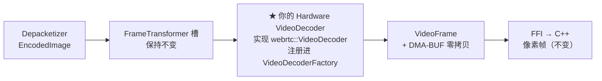
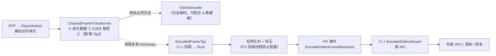
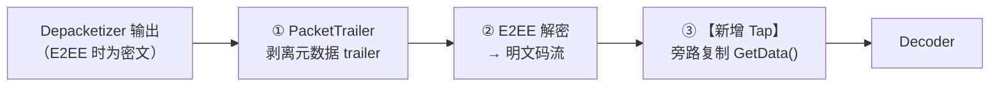
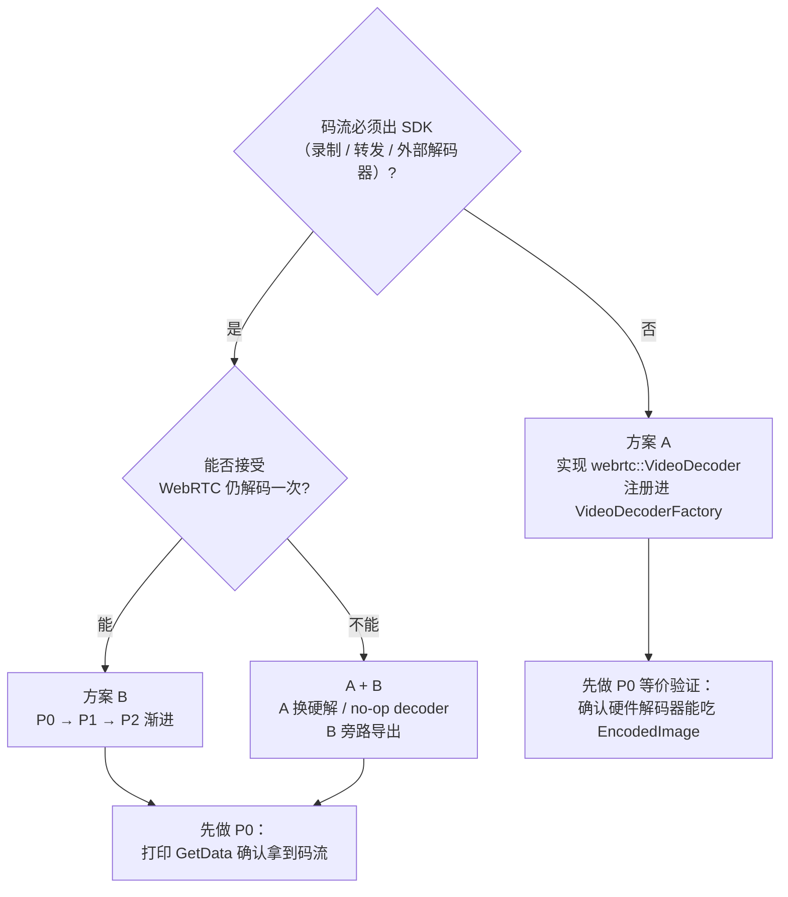
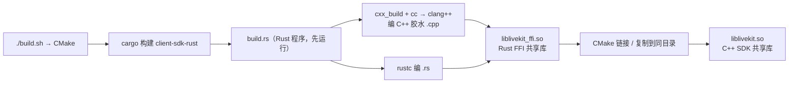

# LiveKit C++ SDK：获取下行未解码视频流（嵌入式硬件解码）方案分析

> 分析基线：`client-sdk-cpp` @ `980332b`（main），`client-sdk-rust` 锁定于 `ede8ac53843a8fb91d6f4fb5629f5245f1758e38`（同时挂在 `livekit/v0.10.0`、`livekit-ffi/v0.13.3` 等 10 个 tag 上）。
> 本文全部结论来自静态阅读源码，**未编译、未运行、未做性能实测**；无法确认的部分在文末单独列出。

---

## 0. 结论速览

**能改，但不是加个开关；而且必须先分清你要的是哪一种"未解码"。**

| 诉求 | 定义 | 可行性 | 改动量 |
|---|---|---|---|
| **方案 A** | 让 SDK 内部的 WebRTC 解码器换成你的硬件解码器；C++ 侧仍拿解码后的像素帧 | 可行，仓库已有同类先例 | 集中在 `webrtc-sys`，**不动 FFI 协议、不动 C++ 公开 API** |
| **方案 B** | 把**压缩码流本身**旁路导出给应用 / 外部 VPU（真正的"未解码下行流"） | 可行，仓库里已有可照抄的接收侧拦截通道 | 跨 4 层新增 API，属于 fork 级改动 |

**不能**只改 C++ SDK、或给现有 `VideoStream` 加个参数来实现——接收端 sink 的类型决定了拿到的必然是解码后的像素帧。

针对"嵌入式设备做硬件解码"这个目标，**推荐以 A 为主**；只有当码流必须落到自己的解码器 / 录制 / 转发时，才上 B（或 A+B 组合）。

---

## 1. 现状（Baseline）

### 1.1 当前工程状态（本次会话的实际上下文）

| 项 | 状态 |
|---|---|
| `client-sdk-rust` 主仓库 | 刚拉齐，HEAD = `ede8ac5…`，与父仓库 gitlink 精确一致 |
| 嵌套子模块 | `livekit-protocol/protocol` @ `3fbe5098…`、`yuv-sys/libyuv` @ `91727608…`，均已初始化 |
| `cpp-tools/` 子模块 | 仍未初始化，`clang-format` / `clang-tidy` 配置链接缺失，尚不能跑 lint |
| 构建 | **未编译、未运行**，以下均为静态源码判断 |
| 工作区约定 | `/home/yt/work/AGENTS.md`：`sdks/` 为只读参考；当前仓库 `AGENTS.md`：Rust 拥有业务逻辑、公开 API 不得破坏、涉及 `client-sdk-rust` 子模块的架构改动需先与开发者确认、不得改自动生成代码 |
| 发布约束 | `rust-release-check.yml` 要求 pin 的 Rust commit 对应已发布 release，一旦改 Rust 侧即成为私有 fork |

线程模型约束（来自当前仓库 `AGENTS.md`）：FFI 回调线程（Rust Tokio 线程）**禁止阻塞**；`RoomDelegate` 与流回调都在此线程；每订阅 reader 线程上限 20。这直接决定方案 B 的事件泵必须异步、带背压。

### 1.2 下行视频链路：现在拿到的一定是解码后的帧


逐层源码证据：

1. `client-sdk-rust/webrtc-sys/include/livekit/video_track.h:74-85` — `NativeVideoSink : webrtc::VideoSinkInterface<webrtc::VideoFrame>`，回调为 `OnFrame(const webrtc::VideoFrame&)`。VideoSink（视频帧接收器）收到的 `VideoFrame` 已是解码后的原始图像。
2. `client-sdk-rust/libwebrtc/src/native/video_stream.rs:53-58,128-140` — `NativeVideoStream` 把 sink 的 `video_frame_buffer()` 塞进 Rust `VideoFrame`。
3. `client-sdk-rust/livekit-ffi/src/room_apis/server/video_stream.rs:151-183` — 事件泵执行 `colorcvt::to_video_buffer_info(...)`，再发 `VideoFrameReceived`。
4. `client-sdk-rust/livekit-ffi/protocol/video_frame.proto:164-192,209-237` — `VideoBufferType` 全为像素格式（RGBA / I420 / NV12 …），`VideoStreamEvent` 只有 `frame_received` / `eos`，`VideoStreamType` 只有 `NATIVE / WEBGL / HTML`。
5. `client-sdk-rust/livekit-ffi/src/room_apis/server/requests.rs:489-502,1418-1419` — 建流入口只有 `NewVideoStream` 与 `VideoStreamFromParticipant`，都汇入同一条链路。

### 1.3 一个极易误判的点：encoded 支持只在发送侧

仓库里确实有 `EncodedVideoFrameBuffer` 和 `VIDEO_SOURCE_ENCODED`，但它们是**发布 / 上行**方向：

- `video_frame.proto:85-106,250-253`：`CaptureEncodedVideoFrameRequest`、`VIDEO_SOURCE_ENCODED`、`EncodedVideoBufferInfo` 是"推送预编码访问单元去发布"。
- `webrtc-sys/include/livekit/encoded_video_frame_buffer.h:60-96`：注释明确写着 "on the **send** path"、"asks the **capture side** to produce a keyframe"，配合 `webrtc-sys/src/passthrough_video_encoder.cpp` 使用。
- `webrtc-sys/CHANGELOG.md:329` 也把这条称为 "pre-encoded video **publish** path"。

> **结论：接收侧目前没有任何编码帧输出通道。** 不要因为看到这些文件就以为改个 `VideoStreamType` 就行。

---

## 2. 需求拆解与判别

目标："让嵌入式设备进行硬件解码"。这句话其实对应两种不同系统形态：

| | 方案 A | 方案 B |
|---|---|---|
| 谁调用硬件解码器 | WebRTC 内部（你提供 `VideoDecoder` 实现） | 你的应用 / 独立进程 / 外部 VPU |
| 码流是否出 SDK | 否 | **是** |
| C++ 侧最终产物 | 解码后的像素帧 | 压缩访问单元（H264/H265/VP8/AV1…） |
| 典型场景 | 只想省 CPU、画面照常渲染 | 码流要录制、转发、喂给自有解码管线、多路分发 |

**必须先回答的问题**：硬件解码器是否接受"WebRTC 回调式输入"？
- 接受（能封装成 `webrtc::VideoDecoder`）→ A 足够，代价最小。
- 不接受（只吃裸流文件/队列、或解码器在另一个进程/芯片上）→ 必须 B。

共同约束（两条路都绕不开）：

- **codec 协商**：嵌入式硬解通常只吃 H264 / H265，而 LiveKit 服务端（SFU，选择性转发单元）可能下发 VP8 / VP9 / AV1。需在订阅时约束 codec。
- **格式**：H264 的 SPS/PPS（解码参数集）、AVCC ↔ Annex-B 封装；H265 的 VPS/SPS/PPS；AV1 的 OBU。
- **时间**：RTP timestamp → PTS（显示时间戳）、关键帧标志、丢包 / 乱序。
- **E2EE**：端到端加密开启时，码流在解密前是密文。
- **simulcast**：SFU 可能同时下发多路不同分辨率的层，切换时 SSRC 会变。

---

## 3. 方案 A 深化：让 WebRTC 内部使用硬件解码器



> 只替换解码器，链路其余部分不变：**不改 FFI 协议、不改 C++ 公开 API、不改 libwebrtc 补丁**。

### 3.1 落点：`VideoDecoderFactory`

`client-sdk-rust/webrtc-sys/src/video_decoder_factory.cpp:72-92,137-185` 定义 `livekit_ffi::VideoDecoderFactory : webrtc::VideoDecoderFactory`，内部维护 `factories_` 列表，`Create()` 按 `SdpVideoFormat` 依次匹配并返回 `std::unique_ptr<webrtc::VideoDecoder>`。

已内置的硬件解码器：

| 平台 | 注册位置 |
|---|---|
| Apple VideoToolbox / Android MediaCodec | `video_decoder_factory.cpp:74-80` |
| NVIDIA NVDEC | `video_decoder_factory.cpp:82-86`（`USE_NVIDIA_VIDEO_CODEC`），另有 `LK_DISABLE_NVDEC` 开关（`webrtc-sys/CHANGELOG.md:363`） |

**缺口**：全仓库 `*decoder*` 实现只有 `webrtc-sys/src/nvidia/` 下 3 个文件 + `video_decoder_factory.cpp`；`vaapi/`、`jetson/` 目录里**只有 encoder，没有 decoder**。Rockchip MPP / V4L2 / 通用 VPU 硬解均不存在，需要新增。

### 3.2 实施步骤（逐文件）

| # | 文件 | 改动 |
|---|---|---|
| 1 | `webrtc-sys/src/<soc>/xxx_decoder_impl.{h,cpp}`（新增） | 实现 `webrtc::VideoDecoder` |
| 2 | `webrtc-sys/src/<soc>/xxx_decoder_factory.{h,cpp}`（新增） | `GetSupportedFormats()` / `QueryCodecSupport()` / `Create()` |
| 3 | `webrtc-sys/src/video_decoder_factory.cpp:72-92` | 在构造函数按平台宏 `factories_.push_back(...)` |
| 4 | `webrtc-sys/build.rs` | 加入新 `.cpp` 与条件编译宏 |
| 5 | `webrtc-sys/Cargo.toml`（可选） | feature 开关，便于非该平台构建时裁掉 |

### 3.3 `VideoDecoder` 接口要点

参照 `webrtc-sys/src/nvidia/h264_decoder_impl.cpp:90` 的现成实现：

```cpp
int32_t Decode(const webrtc::EncodedImage& input_image,
               bool missing_frames,
               int64_t render_time_ms) override;
```

- **输入**：`EncodedImage`（一帧压缩后的编码图像）——这正是硬件解码器需要的东西，**不需要**方案 B 的旁路通道。
- **需实现**：`Configure(const VideoDecoder::Settings&)`、`RegisterDecodeCompleteCallback(DecodedImageCallback*)`、`Release()`；解码完成后回调 `DecodedImageCallback::Decoded(VideoFrame&)`。
- **输出**：`webrtc::VideoFrame` + `VideoFrameBuffer`。仓库已有 `webrtc-sys/include/livekit/dmabuf_video_frame_buffer.h`，嵌入式可考虑 DMA-BUF 零拷贝，避免一次显存→内存拷贝。
- **格式适配**：`input_image.data()` 是 RTP 解包后的访问单元；H264 需补齐 SPS/PPS 并统一成硬解要求的 Annex-B（或 AVCC，取决于 VPU 驱动）。

### 3.4 SDP 与 codec 协商（容易漏的一步）

`GetSupportedFormats()`（`video_decoder_factory.cpp:94-119`）决定 SDP（会话描述协议，用来协商 codec）里对外声明的解码能力。`video_decoder_factory.cpp:45-69` 的 `IsInternalH264DecoderAvailable()` 是个很好的先例：**先实际探测解码器能否 `Configure()` 成功，再决定是否对外声明支持**，避免声明了却解不了。

因此：
1. 新工厂只声明硬解真正支持的 codec（如 H264 / H265）。
2. 订阅时仍需在 `RoomOptions` / 订阅选项侧约束 codec，否则 SFU 可能选 VP8/AV1，硬解无事可做。
3. 注意 `video_decoder_factory.cpp:146-165`：H264 的 `packetization-mode` 严格匹配会失败，代码已做了放宽重试——新工厂要沿用这个逻辑，否则 SDP 协商会对不上。

### 3.5 下游仍有的一次拷贝

即使解码在硬件里完成，`livekit-ffi/src/room_apis/server/video_stream.rs:159` 的 `colorcvt::to_video_buffer_info(frame.buffer, dst_type, normalize_stride)` 仍会按 C++ 请求的目标格式做转换。若硬件输出本身就是 NV12 / DMA-BUF，可考虑新增一种 `VideoBufferType` 或走零拷贝句柄，进一步省掉这次转换——这属于 A 方案的可选优化，不是必需。

### 3.6 验证方式

`webrtc-sys/test/` 下已有 `benchmark_nvidia.h`、`benchmark_vaapi.h`、`benchmark_openh264.h` 等编解码基准，可照此加一个硬件解码基准，观测：CPU 占用、解码帧率、端到端延迟、丢帧率、首帧时间。

### 3.7 工作量与风险

- **改动面**：仅 `webrtc-sys`（C++）+ `build.rs`，不碰 `livekit-ffi/protocol`、不碰 C++ 公开 API，**向后兼容最好**。
- **风险**：VPU 驱动的码流格式适配、异步解码回调与 WebRTC 线程的对齐、多实例并发、`Configure` 失败时的降级（是否回退软解）、平台条件编译。
- **局限**：**拿不到码流**，无法自己录制 / 转发 / 多路分发；仍受 WebRTC 解码管线与渲染时序约束。

---

## 4. 方案 B 深化：旁路导出未解码码流

### 4.1 原理：接收侧已有 `FrameTransformer` 通道，不必改 libwebrtc 本体

`RtpReceiverInterface::SetDepacketizerToDecoderFrameTransformer` 把 FrameTransformer（帧变换器，WebRTC 的可插拔钩子）插在 **depacketizer（RTP 包重组回一帧）之后、解码器之前**，因此能拿到未解码的编码帧。

源码证据（这条链已经在本仓库跑通，不是设想）：

| 用途 | 位置 |
|---|---|
| E2EE 接收侧挂解密变换器 | `webrtc-sys/src/frame_cryptor.cpp:164` |
| 帧元数据接收侧挂 `PacketTrailerHandler` | `webrtc-sys/src/packet_trailer.cpp:641-648` |
| **接收侧直接读编码帧字节** | `webrtc-sys/src/packet_trailer.cpp:303-307`：`TransformReceive()` 里 `frame->GetData()`，另有 `GetSsrc()`、`GetTimestamp()` |
| 三个阶段定义 | `libwebrtc/src/native/packet_trailer.rs:50-59`：`WebrtcReceive`（RTP 解包后的编码帧）→ `DecoderUpload`（交给解码器）→ `DecoderOutput`（解码帧给 sink） |
| 挂接入口 | `libwebrtc/src/native/packet_trailer.rs:271-281` 的 `create_receiver_handler(peer_factory, receiver: &RtpReceiver)`；`livekit/src/room/track/remote_video_track.rs:182-194` 用 `transceiver.receiver()` 取得 |

> 结论：照着 `PacketTrailerTransformer` 写一个"复制并旁路导出"的变换器即可拿到码流，**不需要给 libwebrtc 打补丁**。`webrtc-sys/libwebrtc/patches/` 下 14 个补丁都是构建/兼容/外部音频源相关，没有旁路解码相关的。

### 4.2 目标架构



### 4.3 分阶段实施（强烈建议先做 P0）

| 阶段 | 内容 | 改动 | 目的 |
|---|---|---|---|
| **P0 可行性验证** | 新写一个最小 `FrameTransformer`，只在 `Transform` 里打印 `GetData().size()`、`GetSsrc()`、`GetTimestamp()`，并调用 `OnTransformedFrame` 交还 | 1 个 C++ 文件 + 挂到 `create_receiver_handler` | 用最小代价确认"能稳定拿到码流、帧是否完整、E2EE 下是否明文" |
| **P1 内部通道** | 加 cxx 桥把 `GetData()` 回调到 Rust，建 `EncodedFrameTap` + 有界队列 | `webrtc-sys` 的 `.rs` / `.h` / `.cpp`，`libwebrtc` 新模块 | 打通 C++ → Rust，验证线程与背压 |
| **P2 对外 API** | proto 新消息 + FFI server 事件泵 + C++ SDK 新流类型与回调 | 跨 4 层（见 4.4） | 应用真正可用 |

### 4.4 逐层改动清单

| 层 | 文件 | 改动 |
|---|---|---|
| 协议 | `livekit-ffi/protocol/video_frame.proto` | **新增** `VideoStreamType` 枚举值（不得改现有值）、`NewEncodedVideoStreamRequest`、`EncodedVideoFrameReceived` |
| 协议 | `livekit-ffi/protocol/ffi.proto` | 注册新 request / event 变体 |
| C++ 绑定 | `webrtc-sys/include/livekit/*`、`webrtc-sys/src/*` | `EncodedFrameTapTransformer` + cxx 桥（`rust::Box<...>` 回调） |
| Rust 核心 | `libwebrtc/src/native/*` | 新 handler、队列、receiver 挂接 |
| FFI 服务 | `livekit-ffi/src/room_apis/server/video_stream.rs`、`requests.rs`、`conversion/video_frame.rs` | 参照 `native_video_stream_task`（`:133-206`）做编码帧事件泵 |
| C++ SDK | `include/livekit/*`、`src/*` | 新 `EncodedVideoStream` / 回调注册；遵守 FFI 回调线程不阻塞、reader 线程上限 20 |

### 4.5 协议设计草案

`EncodedVideoFrameReceived` 建议字段（仅供参考，需按实际 `TransformableVideoFrameInterface` 能力裁剪）：

```
codec            : VideoCodec        // 复用 video_frame.proto:144-150
payload          : bytes             // GetData() 拷贝或零拷贝句柄
frame_type       : EncodedFrameType  // KEY / DELTA，复用 :152-155
rtp_timestamp    : uint32
ssrc             : uint32
width / height   : uint32            // 若可从元数据取得
is_keyframe      : bool
sequence         : uint64            // 用于检测丢弃
metadata         : FrameMetadata     // 复用 :199-203
```

`VideoStreamType` 新增值只能**追加**，不能改动 `NATIVE=0 / WEBGL=1 / HTML=2`——当前仓库 `AGENTS.md` 明确要求公开 API 不得破坏向后兼容。

### 4.6 六个硬约束（这部分不粉饰）

**① 单槽 + 链式，绝不能覆盖**
每个 `RtpReceiverInterface` 只有一个 depacketizer→decoder 变换器槽，已被 E2EE 与 PacketTrailer 占用，靠 `ChainedFrameTransformer`（`webrtc-sys/src/frame_cryptor.cpp:32-78,188-219`）串联。新 Tap 必须接进这条链。顺序在接收侧是 `first = timestamp_transformer, second = e2ee_transformer`（`:204-206`）：**若房间开启 E2EE，只有解密之后的节点才能拿到明文码流**，Tap 必须排在解密之后。



**② 不能吞帧**
`packet_trailer.cpp:378` 必须执行 `cb->OnTransformedFrame(std::move(frame))` 把帧交还管线，否则解码器收不到数据，渲染、统计、PLI（关键帧请求）全部异常。Tap 只能**旁路复制**。这意味着 libwebrtc 仍会跑一次解码，白耗 CPU——除非配合方案 A 换成硬解，或注册一个 no-op decoder。

**③ 拿到的是"访问单元"，不是现成裸流**
`GetData()` 给的是 RTP 解包后的一帧压缩数据，需按 codec 处理：

| codec | 需要处理的格式问题 |
|---|---|
| H264 | SPS/PPS 补齐、AVCC ↔ Annex-B 转换、IDR 判定 |
| H265 | VPS/SPS/PPS、Annex-B |
| VP8 / VP9 | 帧头 / uncompressed header、关键帧标志 |
| AV1 | OBU 边界；`packet_trailer.cpp:308` 已用 `av1::IsAv1Frame()` 特判 |

发送侧 `livekit-capture/src/encoded/h26x.rs` 有 H26x 处理可借鉴，但**接收侧没有现成转换代码**。

**④ 时间、丢包与 simulcast**
需要 RTP timestamp → PTS、关键帧标志、帧序号。`packet_trailer.cpp:321-337` 专门处理了 simulcast（同时下发多路不同分辨率层）切换导致的 SSRC 变化并清理旧条目——说明这些坑是真实存在的，Tap 的实现要照此处理，否则层切换后时间戳会碰撞。

**⑤ 线程与背压**
当前仓库 `AGENTS.md`：FFI 回调线程（Rust Tokio 线程）**禁止阻塞**，所有 `RoomDelegate` 与流回调都在此线程；每订阅 reader 线程上限 20。因此 Tap 回调里只能做一次内存拷贝 + 入有界队列，绝不能等 VPU、写文件、或做同步解码；队列满时要有明确的丢帧策略（参考 `libwebrtc/src/native/video_stream.rs:147-301` 的 `VideoFrameQueue`，已实现 latest / bounded / unbounded 三种策略）。

**⑥ codec 协商**
嵌入式硬解多只支持 H264/H265，需在订阅选项侧约束，否则拿到硬解不了的码流。

### 4.7 验收建议

- P0：日志确认每帧 `GetData().size() > 0`、RTP timestamp 单调递增、关键帧间隔合理；E2EE 开/关两种情况都测。
- P1：压测队列不阻塞 FFI 线程（观察回调延迟 P99）；simulcast 层切换时无崩溃 / 无时间戳回退。
- P2：端到端把码流喂给硬件解码器，比对解码帧率、花屏率、与 WebRTC 自身解码的画面一致性。

### 4.8 工作量与风险

- **改动面**：4 层、约 10+ 文件，含 proto 与 C++ 公开 API 扩展。
- **风险**：破坏 E2EE / 帧元数据链、吞帧导致解码异常、码流格式适配、线程阻塞、协议兼容性、fork 升级冲突。
- **维护**：全部落在 `client-sdk-rust` 子模块；`rust-release-check.yml` 要求 pin 对应已发布 release，改动后即私有 fork，后续要反复合并。

---

## 5. 结合现状的对比

### 5.1 多维对比矩阵

| 维度 | 现状（不改） | 方案 A（硬解替换） | 方案 B（旁路码流） | A + B |
|---|---|---|---|---|
| 能否满足"硬件解码" | 否（默认软解） | **是** | 是（由外部硬解） | **是（最完整）** |
| 应用能否拿到压缩码流 | 否 | 否 | **是** | **是** |
| 解码 CPU 收益 | 无 | **高**（硬解 + 无需二次解码） | 中（WebRTC 仍软解一次，除非换 no-op） | **高** |
| 改动层数 | — | 1 层（`webrtc-sys`） | 4 层 | 4 层 |
| 是否动 FFI proto | — | 否 | **是** | 是 |
| 是否动 C++ 公开 API | — | 否 | **是（新增）** | 是（新增） |
| 是否动 libwebrtc 补丁 | — | 否 | 否 | 否 |
| 向后兼容风险 | — | 低 | 中（新增枚举/消息需谨慎） | 中 |
| E2EE 兼容性 | 正常 | 正常 | **需处理链式顺序** | 需处理 |
| 码流格式适配工作量 | — | 中（解码器输入侧） | **高（导出后按 codec 转换）** | 高 |
| 平台适配成本 | — | 需自写 SoC 解码器 | 需自写 Tap，与 SoC 无关 | 两者都要 |
| 验证难度 | — | 中（有现成 benchmark 可参照） | 高（需端到端） | 高 |
| fork 维护成本 | — | 中（仅 webrtc-sys） | **高（跨层）** | 高 |
| 与仓库现状的契合度 | — | **好**：不动协议/公开 API，符合 `AGENTS.md` 约束 | 差：需先与开发者确认架构改动 | 差 |

### 5.2 决策树



### 5.3 针对"嵌入式硬件解码"的推荐

1. **首选 A**：目标只是省 CPU、画面照常渲染时，A 的收益/风险比最好，且**不动 FFI 协议与 C++ 公开 API**，与当前仓库 `AGENTS.md` 的约束最契合。当前缺口很明确——没有 Rockchip/V4L2/MPP 的 `VideoDecoder`，照 `nvidia/h264_decoder_impl.cpp` 补一个即可。
2. **先验证再扩展**：无论选哪条，都先做一个"最小可验证"步骤（A：解码器能 `Configure` + 吃 `EncodedImage`；B：`Transform` 里能打印 `GetData().size()`），再谈协议与 API。
3. **必须 B 时**：严格按 P0 → P1 → P2，先把 `ChainedFrameTransformer` 顺序和"不吞帧"两件事做对，再往外扩。
4. **结合当前工程状态**：`cpp-tools/` 未初始化、尚未构建，任何改动前先补齐工具链并跑一次基线构建；涉及 `client-sdk-rust` 的架构改动，按 `AGENTS.md` 要求先与开发者确认，并评估 `rust-release-check.yml` 带来的 fork 维护成本。

---

## 6. 风险与未验证项（诚实声明）

- 本文**全部为静态源码阅读**，未编译、未运行、未做性能实测；所有"可行"是架构层面的判断，不是已验证的结论。
- `webrtc::TransformableVideoFrameInterface` 的完整接口（`GetPayloadType()`、`Metadata()`、关键帧判定、`GetDirection()` 等）在本仓库里只有 include 引用，libwebrtc 本体是外部预编译库；具体可用方法需对照实际头文件确认，**我无法从本仓库源码打包票**。
- 我**没有找到**任何现成的"接收侧编码帧 FFI 通道"：`livekit-ffi/protocol`、`livekit-ffi` server、C++ SDK 里都没有。
- 我**没有找到** Rockchip / V4L2 / MPP / VAAPI 的解码器实现；`vaapi/`、`jetson/` 目录只有 encoder。
- `VideoDecoderFactory` 的注册顺序、`QueryCodecSupport` 的 `reference_scaling` 分支（`video_decoder_factory.cpp:121-135`）对新 codec 的影响，需要实际联调 SDP 才能确认。
- 本仓库 `AGENTS.md` 要求：涉及 `client-sdk-rust/` 子模块的架构改动先与开发者确认；不要改自动生成代码；公开 API 不得破坏。

---

## 7. 附录：源码索引

| 主题 | 位置 |
|---|---|
| 接收 sink 类型 | `webrtc-sys/include/livekit/video_track.h:74-85` |
| NativeVideoStream | `libwebrtc/src/native/video_stream.rs:53-58,128-140` |
| 有界队列 / 背压 | `libwebrtc/src/native/video_stream.rs:147-301` |
| FFI 视频事件泵 | `livekit-ffi/src/room_apis/server/video_stream.rs:133-206` |
| 视频协议（像素格式 / 流事件） | `livekit-ffi/protocol/video_frame.proto:164-192,209-237` |
| 发送侧 encoded（易误判） | `video_frame.proto:85-106,250-253`；`webrtc-sys/include/livekit/encoded_video_frame_buffer.h:60-96` |
| 解码器工厂 | `webrtc-sys/src/video_decoder_factory.cpp:72-92,94-119,137-185` |
| 硬件解码器范例 | `webrtc-sys/src/nvidia/h264_decoder_impl.cpp:90` |
| DMA-BUF 帧缓冲 | `webrtc-sys/include/livekit/dmabuf_video_frame_buffer.h` |
| 接收侧 FrameTransformer 通道 | `webrtc-sys/src/packet_trailer.cpp:641-648`；`webrtc-sys/src/frame_cryptor.cpp:164` |
| 接收侧读取编码帧字节 | `webrtc-sys/src/packet_trailer.cpp:303-307` |
| 三阶段定义 | `libwebrtc/src/native/packet_trailer.rs:50-59` |
| 链式变换器 / 顺序 | `webrtc-sys/src/frame_cryptor.cpp:32-78,188-219` |
| 必须交还帧 | `webrtc-sys/src/packet_trailer.cpp:378` |
| simulcast / SSRC 切换处理 | `webrtc-sys/src/packet_trailer.cpp:321-337` |
| 接收侧 handler 创建 | `libwebrtc/src/native/packet_trailer.rs:271-281` |
| handler 挂到 track | `livekit/src/room/track/remote_video_track.rs:182-194` |
| 尚未实现的绑定 TODO | `webrtc-sys/include/livekit/rtp_receiver.h:36-38` |
| libwebrtc 补丁清单 | `webrtc-sys/libwebrtc/patches/`（14 个，均为构建/兼容相关） |
| 发布版本校验 | `.github/workflows/rust-release-check.yml` |

---

## 8. 工程落地补充（后续对话要点）

> 本章汇总后续几轮围绕"改完源码后如何编译、如何拿到 arm64 产物"的结论，是第 3~5 章实施方案的落地衔接。全部仍是静态源码阅读 + 官方文档核对，**未编译、未实测**；第 6 章的所有未验证声明依然成立。

### 8.1 混合构建：C++ 与 Rust 编译器各管一段

`client-sdk-rust` 是**混合仓库**：`webrtc-sys/src/*.cpp` 用 C++ 编译器，`*.rs` 用 rustc，由 cargo 的构建脚本（`build.rs`，正式编译前先编译并运行的一段 Rust 程序）统一调度。

| 文件 | 编译器 | 依据 |
|---|---|---|
| `webrtc-sys/src/*.cpp`（含 `video_decoder_factory.cpp`） | **clang++**（Linux 显式指定）/ MSVC（Windows） | `build.rs:67-102`（第 90 行即该文件）、`:401 .compile("webrtcsys-cxx")`（cc crate 启动 C++ 编译器产出静态库）、`:546 builder.compiler("clang++")` |
| `webrtc-sys/src/*.rs` | **rustc** | `lib.rs` 普通模块；`#[cxx::bridge]` 双向声明见 `video_track.rs:21,84,142` |
| `build.rs` 自身 | rustc 编译后**运行** | `Cargo.toml:22-27` 的 `cxx-build` / `cc` / `webrtc-sys-build` |
| C++ SDK `src/*.cpp` | CMake 调用的 C++ 编译器 | 最终产出 `liblivekit.so` |



补充证据与约束：

- `Cargo.toml:19` `cxx`、`Cargo.toml:22-27` `cxx-build` / `cc`、`Cargo.toml:7` description 为 "Unsafe bindings to libwebrtc"；`video_track.h:40` 会 `#include "webrtc-sys/src/video_track.rs.h"` —— 由 Rust 侧 `#[cxx::bridge]` 生成的 C++ 头。
- **不能用 GCC**：`build.rs:531-547` 说明预编译 `libwebrtc.a` 使用 Chromium hermetic libc++，`trivial_abi` 会改变调用约定，GCC 静默忽略后会让 `std::unique_ptr` / `shared_ptr` 首次使用即变野指针。因此 Linux 强制 clang++ 21+（`setup-sdk-deps/action.yml:56-76` 装 clang-21，`setup-linux-toolchain.sh:77` 要求 ≥21）。
- **对方案 A 的硬约束**：新增 SoC 解码器 `.cpp` 必须登记进 `build.rs:67-102` 的 `builder.files(...)`，否则**根本不参与编译**；平台分支在 `:160-171`（Windows `/std:c++20`）、`:203-223`（Linux VAAPI）、`:225-245`（Jetson）。改动后必须重跑 `./build.sh`（`AGENTS.md` 禁止直接调 CMake），单独 `g++` 编一个文件无效。

### 8.2 最终产物：两个 so（更正此前口头说法）

`docs/building.md:352-361`：发布包打包 **`liblivekit.so`（C++ 层）** 与 **`liblivekit_ffi.so`（Rust FFI 层）**，Linux 上前者用 `$ORIGIN` runpath（相对自身目录定位依赖库的机制）找同目录的后者。

- `CMakeLists.txt:352-356` 把 `${RUST_TARGET_DIR}/release/liblivekit_ffi.so` 声明为 `IMPORTED SHARED` 目标（库由外部 cargo 编好，CMake 只引用 / 链接 / 复制）；`:530` 链接、`:562+` 复制到同目录。
- `CMakeLists.txt:274-285` 按 `LIVEKIT_CAPTURE` 的 feature 组合算 hash 隔离 Cargo 输出目录 —— 这就是 standard / capture 两个 bundle 要各编一次 Rust 的原因。
- **更正**：此前口头回答里"Rust 静态库链进 `liblivekit.so`"不准确，实际是**两个共享库**动态依赖。

### 8.3 GitHub arm64 公共 runner 的编译原理

GitHub 官方文档（当前）：公共仓库的标准托管运行器**免费且不限量**；`ubuntu-22.04-arm` / `ubuntu-24.04-arm` 为 4 vCPU / 16 GB / arm64。本仓库 CI 已在使用（`builds.yml:35-36,39-40`、`make-release.yml:32-37`、`tests.yml:153-161`）。

**原理：原生编译，不是交叉编译。** VM 的 CPU 本身就是 aarch64，系统自带 aarch64 glibc 与头文件，因此：

- `CMakeLists.txt:264-272` 的 `RUST_TARGET_TRIPLE` 只在 macOS 设置了 `CMAKE_OSX_ARCHITECTURES` 时赋值，Linux 为空；
- `cmake/run_cargo.cmake:35-38` 只有该值非空才追加 `--target`，Linux 不加 → cargo 用 host triple `aarch64-unknown-linux-gnu`；
- 无需 QEMU（指令模拟）、无需交叉工具链、无需目标板 sysroot（目标系统头文件与库的根目录）。

```mermaid
flowchart LR
    A["workflow_dispatch<br/>builds.yml"] --> B["派发 ubuntu-22.04-arm VM<br/>原生 aarch64"]
    B --> C["checkout + submodules: recursive<br/>+ git lfs pull"]
    C --> D["setup-sdk-deps<br/>clang-21 / Rust stable"]
    D --> E["./build.sh release-examples<br/>--bundle --prefix ..."]
    E --> F["CMake → run_cargo.cmake<br/>cargo build -p livekit-ffi --release"]
    F --> G["liblivekit_ffi.so + liblivekit.so"]
    G --> H["cmake --install → bundle"]
    H --> I["upload-artifact<br/>standard / capture（7 天）"]
```



代价：编译期链接的就是这台 VM 的系统库 —— **Ubuntu 22.04 glibc 2.35**（24.04 为 2.39）、系统 `libstdc++`、`libcurl.so.4`（`docs/building.md:368-370`）。官方按 OS 版本分别打包（`make-release.yml:309`），正因为产物绑定 glibc 基线。**这与第 5.3 / 6 章的嵌入式 sysroot 陷阱一致：CI 产物是"Ubuntu arm64 服务器能用的库"，不是任意 arm64 Linux 都能用。**

### 8.4 "触发工作流即得到 so"的精确化

理解正确，但有 5 点必须限定：

1. **指对 workflow**：只有 `builds.yml` / `make-release.yml` 产 so；`ci.yml` 只是聚合器（通过 `workflow_call` 调用 builds），`tests.yml` / `docs.yml` / `cpp-tools.yml` / `license_check.yml` / `link_check.yml` / `rust-release-check.yml` 都不产出。
2. **触发方式**：`builds.yml:4-6` 支持 `workflow_call` + `workflow_dispatch`（无 inputs）；`ci.yml:17-20` 说明手动 dispatch 会强制跑全部阶段，所以**直接 dispatch `builds.yml` 最省**。
3. **矩阵全跑**：`builds.yml:31-48` 写死 7 个平台且 `workflow_dispatch` 无 inputs，无法只选 arm64；`fail-fast: false`（`:30`）保证其他 job 失败不影响 `Build (ubuntu-22.04-arm64)`。
4. **产物是 bundle 非裸 so**：`:186-191` / `:222-228` 上传的是整个安装目录，两个 so 在 `lib/` 下，保留 **7 天**。
5. **触发 ≠ 成功**：子模块递归、LFS、clang-21 / Rust 安装、预编译 libwebrtc 下载、两轮构建，任一步失败都会让 job 挂。

### 8.5 手动触发 `builds.yml` 步骤清单

| 阶段 | 动作 |
|---|---|
| 前置一次性 | 仓库设 Public；启用 Actions（fork 默认禁用）；默认分支保持 `main`；确认 `.github/workflows/builds.yml` 在默认分支上；**无需任何 secrets / inputs**（`builds.yml:8-11` 只读权限） |
| 触发（推荐） | Actions → **Builds** → Run workflow → 分支 `main` → Run；或 `gh workflow run builds.yml --ref main` |
| 触发（不推荐） | Actions → **CI** → Run workflow：会连带 tests / docs / cpp-tools 全部阶段 |
| 等待 | 找 `Build (ubuntu-22.04-arm64)` 变绿；首次冷启动无 cargo 缓存（`:235` 只在 push main 时保存缓存），偏慢 |
| 取产物 | run 页底部 Artifacts：`livekit-sdk-ubuntu-22.04-arm64` 与 `...-capture`；解压取 `lib/` 下两个 so |
| 校验 | `file` / `readelf -h` 确认 aarch64 ELF；`ldd` 检查 glibc、`libcurl.so.4` 依赖 |

常见失败点：无 "Run workflow" 按钮（Actions 禁用 / workflow 不在默认分支）；`git lfs pull` 失败（LFS 对象未迁移，`.gitattributes:1` 只有 `data/welcome.wav`）；子模块递归拉取失败；clang-21 / libwebrtc 下载失败。**若只想跑 arm64，必须改 workflow**（加 input + job `if` 条件，或缩减 matrix），当前配置做不到。

### 8.6 `clone` + `push` 等价 fork，但有差异

**等价依据**：workflow 是普通文件随 commit 走；本地 composite action 用相对路径 `uses: ./.github/actions/build-sdk`（`builds.yml:163`）；第三方 action 全按 commit SHA 固定；子模块是 gitlink（`160000 commit`），CI 用 `submodules: recursive` 自己拉；`builds.yml` 不需继承任何 secrets。

| 差异点 | 处理 |
|---|---|
| 仓库状态 | 新建**完全空**仓库（不勾 README / LICENSE），否则首次 push 非快进被拒；设 Public |
| 默认分支 | 保持 `main`（`builds.yml:235` 写死 `refs/heads/main`） |
| Actions | 新建仓库通常默认启用；fork 默认禁用要手动开 |
| **Git LFS（唯一实质差异）** | 普通 `git push` 不传 LFS 对象，而 `builds.yml:65-66` 会 `git lfs pull`；需 `git lfs push --all <新 remote>`，或去掉 `.gitattributes` 那行与 pull 步骤。本次会话实测本地**未安装 git-lfs** |
| 别踩 | 不要手动 `git add` 子模块目录（本地已初始化成带 `.git` gitfile 的仓库）；首次 push 的 `dorny/paths-filter` 行为不确定，别依赖 push 触发 |
| 合规 | Apache 2.0，保留 LICENSE / NOTICE / 版权头即可公开再分发 |

### 8.7 与本报告结论的衔接

- **方案 A 的落地路径**：改 `video_decoder_factory.cpp` + 新增 SoC `VideoDecoder` 实现的 `.cpp` → 登记进 `build.rs` 对应平台分支 → push 到自己的公共仓库 → 手动 dispatch `builds.yml` → 下载 `ubuntu-22.04-arm64` bundle → 在板子上 `ldd` 验证依赖后再集成。
- **方案 B**：除 Rust 侧跨 4 层改动外，同样需要这条 CI 链路产出可供验证的 arm64 产物。
- **不变的前提**：`cpp-tools/` 子模块仍未初始化、未做构建验证；`client-sdk-rust` 的架构改动按 `AGENTS.md` 需先与开发者确认，且会变成私有 fork（`rust-release-check.yml` 约束）；glibc / sysroot 陷阱不因换仓库获取方式而改变。
- **第 6 章的全部未验证声明仍然成立**：本文所有"可行"均为架构层面判断，未编译、未运行、未实测。

### 8.8 补充源码索引

| 主题 | 位置 |
|---|---|
| C++ 编译清单与编译调用 | `webrtc-sys/build.rs:65,67-102,401` |
| Linux 强制 clang++ 与原因 | `webrtc-sys/build.rs:531-547`；`setup-linux-toolchain.sh:66-80` |
| cxx 桥声明 | `webrtc-sys/src/video_track.rs:21,84,142`；`webrtc-sys/Cargo.toml:19,22-27` |
| 两个 so 与 `$ORIGIN` | `docs/building.md:352-361`；`CMakeLists.txt:352-356,530,562+` |
| Cargo feature hash 隔离 | `CMakeLists.txt:274-285` |
| cargo 调用点 | `CMakeLists.txt:392-411`；`cmake/run_cargo.cmake:25-38` |
| 原生编译（无 --target） | `CMakeLists.txt:264-272` |
| CI arm64 矩阵 | `.github/workflows/builds.yml:31-51`；`make-release.yml:32-37` |
| workflow 触发器 | `builds.yml:4-6`；`ci.yml:3-9,17-20` |
| 产物上传与保留期 | `builds.yml:186-191,222-228` |
| 依赖安装 / git lfs | `.github/actions/setup-sdk-deps/action.yml:44-76`；`builds.yml:56-66`；`.gitattributes:1` |
| 发布包按平台分包 | `make-release.yml:309-318` |
